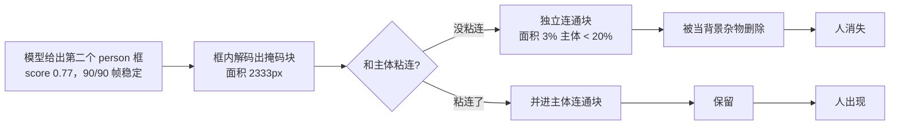

# 后面的人忽隐忽现 — 根因与修复

> 日期：2026-11-04
> 场景：yolov8s-seg（`y8s_rkv.rknn`）人像抠像，RK3576 板端实时
> 相关脚本：`scripts/probe_owner_filter.py` / `verify_owner_port.py` / `trace_components.py`

---

## 0. 一句话结论

**闪烁不是模型的问题，是我们自己的孤立块过滤器 `mask_drop_orphans` 造成的。**

那个"后面的人"在模型侧 90/90 帧都有独立 person 检测框（score 中位数 0.77），
稳定存在。但旧过滤器只看面积 —— 这块只有主体的 3%，远低于 20% 阈值。
于是：

- 这一帧这块**没和主体粘连** → 被当成背景杂物删掉 → 人消失
- 下一帧这块**粘到了主体上** → 并进主体的连通域 → 人又出现

90 帧实测状态切换 **16 次**，10fps 下约 0.5 秒闪一次。

---

## 1. 定位过程（可复现）

### 1.1 先确认模型侧稳不稳

板端 90 帧连续 dump，逐帧跑 NMS 后统计第二人框：

| 指标 | 数值 |
|---|---|
| 独立 person 框存在 | **90 / 90 帧** |
| 缺失帧 | **0** |
| score | min 0.37 / p5 0.57 / median **0.77** / max 0.83 |
| 框位置 | x1 62–70, y1 356–366（固定） |

→ 模型侧完全稳定，闪烁不是检测抖动。

### 1.2 再确认后处理是元凶

同一个 dump，逐帧看「第二人区域」的连通块状态：

```
INDEP×4 MERGED×1 INDEP×1 MERGED×2 INDEP×3 MERGED×3 INDEP×15 MERGED×1 ...
切换 16 次 / 90 帧
```

`INDEP` = 独立连通块（旧过滤器会删），`MERGED` = 粘到主体（旧过滤器留下）。

两个数据集对照：

| 数据集 | 帧数 | 第二人块面积 | 占主体比例 | 20% 阈值 | 结果 |
|---|---|---|---|---|---|
| `/tmp/fa/flick_a` | 90 | 2333 px | 3.0% | 15356 px | **必删** |
| `/tmp/v2/v2` | 5 | 2208 px | 2.6% | — | **必删** |

块面积始终只有主体的 3%~5.6%，**只要脱开就必被删**。这就是忽隐忽现。

### 1.3 用「覆盖率」而不是「块个数」度量可见性

关键口径问题：数「独立连通块个数」会把**粘连帧误判成消失**（其实并进主体、
画面上仍在）。正确口径是第二人检测框内的前景覆盖率：

```
coverage = fg ∩ box / box面积
```

修复前后（`/tmp/fa/flick_a`，90 帧抽 30 帧）：

| 版本 | 覆盖率 mean | std | 可见帧 | 状态切换 |
|---|---|---|---|---|
| 原始模型输出（不过滤，抖动基准） | 0.355 | 0.0296 | — | — |
| **旧规则（纯面积）** | 0.206 | 0.0880 | 10/30 | **10 次** |
| **新规则（按归属框）** | 0.354 | 0.0295 | **30/30** | **0 次** |

新规则的 std 与原始输出只差 **0.0001** —— 过滤器不再添加任何抖动，
残留的 0.03 是人自己在动。

---

## 2. 根因：过滤器用错了判据



**判据错了**：`mask_drop_orphans` 假设「面积远小于主体 = 背景杂物」。
但这个假设对**另一个真实目标**同样成立 —— 远景的人、站在后面的人，
面积本来就小。

而模型其实已经告诉我们答案了：掩码是「框内 protos 解码」出来的，
**每个前景像素天然带归属框**。旧代码把这个信息丢掉了，只留了面积。

---

## 3. 修复：按「归属框」而不是「面积比例」判

### 3.1 改法

`seg_run` 增加可选的 `own` 输出，逐像素记录「这个像素来自第几个保留框」
（`if (p > prob[idx]) { prob[idx] = p; own[idx] = ki; }`，与取最大值同步）。

`mask_drop_orphans` 对每个连通块取块内出现次数最多的 `own` 值作为它的归属：

| 块的归属 | 判据 | 处理 |
|---|---|---|
| **别的检测框** | 模型判定它是 person 的独立目标 | **一律保留**，不看大小 |
| **主体框自己** | 同一根框的噪声碎屑 | 面积 < 主体 × 20% 才删 |
| 无归属（`own = -1`） | 退化情况 | 按旧逻辑（面积）处理 |

`own == NULL` 时整个函数退化成旧行为，方便回退对照。

### 3.2 不变量（已断言）

- **只减不增**：`post ⊆ pre`，逐元素成立
- **主体连通块逐位不变**：过滤器从不碰人
- **主体自己的碎屑仍被清理**：过滤没有被架空（实测 11 个碎屑块被删）

### 3.3 改动位置

`scripts/humanseg_y8seg.cc`：

| 位置 | 改动 |
|---|---|
| `seg_run` | 新增 `signed char* own` 参数；取最大值时同步写归属 |
| `mask_drop_orphans` | 签名 `(float*, const signed char* own, int w, int h, float)`；先算每块归属，再决定删留 |
| `main` | 新增 `owner640` 缓冲，传入调用点 |

`--orphan-frac` / `--keep-orphans` 参数语义不变；`--keep-orphans` 仍然完全关闭过滤。

> 后续重构（三线程流水线，见 `丢帧优化-三线程与ringbuffer.md`）把主循环搬进了
> `infer_thread`，但 `seg_run` / `mask_drop_orphans` 的逻辑一字未动 ——
> 已用 90 帧真实数据对拍确认逐位一致。

---

## 4. 验证

### 4.1 C++ 与 Python 逐位对拍（`verify_owner_port.py`）

把 `.cc` 里的 `mask_drop_orphans` **原文**用正则抽出来、宿主机 g++ 编译、
喂真实帧，与 Python 参考实现逐位比对：

```
C++ 与 Python 新规则逐帧逐位一致         PASS 0 帧不一致
主体连通块逐位不变                      PASS
C++ 版第二人逐帧可见（闪烁场景）           PASS 90/90
C++ 版第二人零状态切换（修复生效）          PASS 0 次
```

> 为什么要抽源码编译而不是信任我的转写：板端只有一个摄像头，无法让
> 旧/新二进制看同一帧。只有「同一份 dump → 两种实现」能锁正确性，
> 而且验证的是 `.cc` 里的文字，不是我脑子里的算法。

### 4.2 板端端到端

修复版二进制约 40896 字节，90 帧实测 9.0 fps（与修复前 9.8 fps 相当，
过滤本身的开销可忽略）。

```
第二人区域覆盖率: mean=0.107 std=0.0063 min=0.091 max=0.121
可见帧 90/90  状态切换 0 次
```

> 注意：这一次采集时人离得较远，块本身就和主体粘连，旧规则下也是 0 次
> 切换 —— **这个场景不能证明修复**。真正的证据是 §1.3 / §4.1 在
> `/tmp/fa/flick_a`（闪烁真实发生的场景）上的数据。

---

## 5. 遗留 / 注意

- **`own` 用 `signed char`，上限 127 个框**。当前 CONF=0.25 下 keep 通常
  1–3 个，够用；若要放宽阈值需改类型。
- 该修复只解决「块归属判定」，**不解决**「框本身把背景框进来」的问题 ——
  后者见 `靠背残留-根因定位.md`。
- 如果场景里确实存在「挂在背景里的衣服」被模型误检成 person，新规则会
  **保留**它（因为模型给了独立框）。这种情况需要从模型/构图侧解决，
  不能用面积硬删 —— 那正是本次闪烁的成因。
- `--orphan-frac` 现在只作用于「主体框自己的碎屑」，调它对第二人不再有影响。

---

## 6. 新增脚本

| 脚本 | 用途 |
|---|---|
| `probe_owner_filter.py` | 新旧规则在真实帧上的覆盖率/切换次数对照 + 不变量断言 |
| `verify_owner_port.py` | 抽 `.cc` 原文编译，与 Python 参考实现逐位对拍 |
| `trace_components.py` | 逐帧把每个连通块溯源到检测框（score / 框面积 / comp÷box） |

```bash
python3 scripts/probe_owner_filter.py --dir /tmp/fa/flick_a --chunk 3
python3 scripts/verify_owner_port.py
python3 scripts/trace_components.py --dir /tmp/fa/flick_a --skip 2
```
