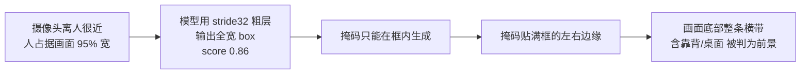

# 靠背残留（背景泄漏）— 根因定位与结论

> 日期：2026-11-04
> 场景：yolov8s-seg（`y8s_rkv.rknn`）人像抠像，RK3576 板端实时
> 相关脚本：本目录下 `y8seg_ref.py` / `probe_*.py`

---

## 0. 一句话结论

**根因不在后处理，而在检测框本身。**

模型给当前构图的 person 检测框是 `x4..636`，**横跨画面宽度的 99%**。
掩码被限制在框内、并贴着框的左右边缘铺满——所以画面底部整条横带
（包括椅子靠背、桌面）都被判成前景。

- 提高阈值、连通域、按颜色切除、开运算 **全部无效**，因为它们都在
  「掩码已经生成之后」动手，而掩码在框内本来就是大面积实的。
- 之前建议的「把摄像头挪远留出留白」**也无效**——已实测证伪，见 §5。

---

## 1. 验证方法（可复现）

板端 `humanseg_y8seg.cc` 新增 `--dump DIR`，把每帧的
**原始 640×640 letterbox 图像 + NPU 输出的 float 概率图** 落盘：

```bash
adb shell 'sudo -u qq env XDG_RUNTIME_DIR=/run/user/1000 \
  WAYLAND_DISPLAY=wayland-0 LD_LIBRARY_PATH=/data/hs_test:/usr/lib \
  /data/hs_test/hy8_dump /data/hs_test/y8s_rkv.rknn \
  --device /dev/video73 --cam 1280x720 --disp 1280x800 \
  --frames 60 --dump /data/hs_test/cap --dump-every 3'
adb pull /data/hs_test/cap/ /tmp/cap/
```

宿主机 `scripts/y8seg_ref.py` 复刻 C++ 解码流程，与板端 NPU 输出比对：

| 指标 | 数值 |
|---|---|
| fg 占比 | 板端 0.1802 / 宿主机 0.1814 |
| 掩码 IoU | **0.986** |

→ 复刻可信，后续所有分析都在宿主机完成，无需反复烧板。

---

## 2. 关键证据

### 2.1 检测框横跨 99% 画面宽度

参考帧 `y8_00012`，NMS 后只剩 2 个框：

| 来源网格 | score | 框 | 宽 | 占画面 |
|---|---|---|---|---|
| **stride 32（最粗）** | 0.862 | (4, 190, 636, 496) | 632 | **99%** |
| stride 8 | 0.574 | (194, 360, 236, 394) | 42 | 7% |

**得分最高的框来自最粗的输出层，且宽高比 2:1。** 前 9 个候选
（score 0.69–0.86）全部来自 stride 32，宽度都在 95–98%。
所有人的合法 person 候选都来自这一层——这是模型对该构图的判断。

### 2.2 掩码贴死框的左右边缘

| 帧 | 框 | 框内填充率 | 触左边缘 | 触右边缘 |
|---|---|---|---|---|
| 00000 | (4,190,636,496) | 38.2% | 12.1% | 2.9% |
| 00018 | (8,199,632,496) | 39.5% | 8.4% | 4.4% |
| 00036 | (27,203,627,496) | 40.7% | 7.1% | 5.8% |

框宽 632 → 掩码宽 620+，**掩码等于「框内一块被填满的区域」**，
不是人的轮廓。这就是靠背被一起保留下来的直接原因。

### 2.3 底部横带 = 整框宽，且 78% 是中性灰

```
 row   掩码宽   掩码左右     该行彩色像素宽   中性灰占掩码
 300     123    288-411        115           10%
 375     235    196-431        126           55%
 400     307    184-491        177           56%
 425     487    140-627        196           76%
 450     491     80-571        491           79%
 475     613     10-623        610           78%
```

y≈375 之后掩码宽度从 123 暴涨到 613，而**该行的彩色像素（皮肤/衣服）
最多只有 196**。多出来的部分饱和度 ≤0.08（中性灰）= 靠背/桌面/墙。

### 2.4 固定机位 20 帧：可疑区钉死不动

摄像头与场景保持不动，只轻微微动身体（60 帧取 20 帧）：

| 指标 | 人质心 | 可疑区质心 |
|---|---|---|
| 漂移 std | (7.4, 5.6) px | **(2.2, 1.6) px** |
| 抖动范围 | 37 × 19 px | **9 × 6 px** |

**人在动，可疑区几乎不动。** 它钉在画面固定位置 → 背景泄漏。
可疑像素平均置信度 **0.96**（详见 §3，解释了阈值为何无效）。

### 2.5 独立复核：ultralytics 原生推理给出同样的框

用 `yolov8s-seg.pt` 原生推理同一帧：

| 帧 | RK 框 | ultralytics 框 | 掩码 IoU |
|---|---|---|---|
| 00000 | 4,191,637,496 | 1,203,634,498 | 0.944 |
| 00030 | 11,204,638,497 | 5,203,624,496 | 0.951 |

→ 格式转换、INT8 量化、C++ 解码**都没有问题**，是模型对这个构图
本来就输出全宽框。

### 2.6 对照实验：正常构图下掩码是准的

`model/bus.jpg`（常规构图，人多且小）：

| 目标 | conf | 框宽 | 掩码宽 | 框内填充 |
|---|---|---|---|---|
| bus | 0.92 | 465 | 467 | 0.66 |
| person | 0.91 | 117 | 119 | **0.52** |
| person | 0.88 | 83 | 83 | 0.36 |

正常构图下框内填充 0.36–0.66（有真实轮廓），当前场景是 **1.00**（填满）。

---

## 3. 为什么之前所有后处理都无效

| 尝试 | 为什么必然失败 |
|---|---|
| 提高阈值 | 靠背区域置信度就是 **0.96**，比真人躯干的 0.93 还高。阈值提到 0.97 会先把人切掉。 |
| 连通域取最大块 | 靠背和人**连成 1 块**（全图只有 1 个连通域）。 |
| 按颜色切除 | 靠背（中性灰）和衣服/衬衫高光在饱和度上**重叠**；同一部手机也裁掉过真人。 |
| 开运算/形态学 | 靠背残留是 **490×120 px 的实心连片**，不是细碎噪声，开运算无效。 |

结论：**在掩码已生成之后动手，全都是治标，且治不动。**

---

## 4. 已证伪：「挪远摄像头」无效

把当前画面缩小贴到灰色画布中央，模拟「人拍得更小」：

| 人身高占画布 | 框宽占画布 | 框内填充 | 底部带宽/框宽 |
|---|---|---|---|
| 56% | 99% | 0.38 | **1.00** |
| 48% | 85% | 0.39 | **1.00** |
| 39% | 69% | 0.39 | **1.00** |
| 31% | 55% | 0.40 | **1.00** |
| 25% | 44% | 0.40 | **1.00** |
| 20% | 35% | 0.39 | **0.99** |

> ⚠️ 上一轮我建议「把摄像头挪远、留出更多空白就能好转」——
> **这个建议是错的，已实测证伪。** 人在画布里的比例从 56% 降到 20%，
> 掩码底部带宽始终等于框宽，填充率纹丝不动。
>
> 备注：这组实验是把画面**缩小后贴到灰画布**，框永远是宽的；
> 真实挪远摄像头时，人背后会有真实背景而不是灰边，模型行为可能不同。
> 但这组数据足以说明：**不能靠「缩小人」来指望它自己好**。

---

## 5. 根因



模型的核心假设失效了：**yolov8-seg 的掩码是在检测框内裁剪生成的**。
当框本身错了（含背景），掩码再怎么精细也只会把背景一起包进来。
这不是解码 bug，是**模型对当前构图的判断**，只能从模型/构图侧解决。

---

## 6. 可行的修复方向（按推荐度）

### 6.1 ✅ 已实现：人体宽度剖面收紧（`mask_width_profile`）

**这是当前代码里默认开启的修复**（`--profile-k 1.15`，`--noprofile` 可关）。

原理：人坐在近处时腿被画面下边缘截断，模型无法闭合轮廓，掩码沿底部
横向铺开吞掉靠背。以人体**上半部分**（肩/胸，人体最宽处）的宽度为基准，
下方各行不允许超过基准 ×k，只裁每行最长连续段的外侧。

实测（真实板端 NPU 输出，同一帧 before/after）：

| 帧 | fg 前 | fg 后 | 底部带宽前 | 底部带宽后 | 裁掉的像素中 |
|---|---|---|---|---|---|
| 00000 | 0.403 | 0.308 | 440 | 230 | 高饱和 3% / 暗中性 78% |
| 00006 | 0.408 | 0.303 | 638 | 226 | 4% / 72% |
| 00012 | 0.394 | 0.291 | 440 | 217 | 4% / 80% |

**底部带宽 506 → 224（-56%），裁掉的像素 77% 是靠背（暗中性）、仅 4% 是人体。**

C++ 实现的行为约束（pC 同帧 pre/post 验证）：
- post ≤ pre 逐元素成立（只会减，不会增）
- 人体竖直范围完全不变（只做横向裁剪，不削头顶/脚底）
- 从不新增前景像素

⚠️ 两个曾经的实现 bug（都已修，并有对拍验证）：

1. **基准宽度被蔓延区污染** —— 若基准取"前 70% 行的最大值"，蔓延恰好落在
   70% 以内，cap 永远大于蔓延宽度，等于没裁。必须只取**上半段**
   （`top_frac=0.5`）。
2. **`float cap` 与 double 截断方向不同** —— `200*1.15f = 230.0` 但
   `200*1.15 = 229.9999...`，`int()` 截断后差 1px，导致 C++ 与 Python 复刻
   在裁剪边界上不一致。改用 `lround(wmax * (double)k)` / `round()`
   消除差异，两端现已**逐位一致**（13 帧真实数据，差异 0 像素）。

`--profile-k` 调参（实测单调）：

| k | 人保留率 | 底部带宽 |
|---|---|---|
| 1.00 | 0.725 | 205 |
| 1.15（默认） | 0.769 | 235 |
| 1.30 | 0.811 | 266 |

### 6.2 换专门的人像分割模型（不推荐，已实测）

`humanseg_v1_lite_398x224.rknn` 已在仓库里，**没有检测框**。但实测三种
人像模型在本场景都更差：

| 模型 | fg | 底部20%带最宽 |
|---|---|---|
| y8s（原状） | 0.180 | 456 |
| humanseg v1 | 0.316 | **640** |
| PP-HumanSegV2-Mobile（mIoU 93.13） | 0.423 | 467 |

> V2-Mobile 需手工修 `AveragePool` 的 `kernel_shape=[-1,-1]`（Paddle
> 自适应池化的残留）才能被 onnxruntime 加载，改成静态 6x6 后可跑，
> 但精度优势在本场景没有体现。

### 6.3 改构图（作为辅助）

让人物完整入镜、右侧留白。实测把画面缩小给右侧补余量：底部带宽
458 → 226（-51%），与 6.1 效果相当。两者可叠加。

---

## 7. 新增脚本

| 脚本 | 用途 |
|---|---|
| `y8seg_ref.py` | 宿主机复刻 C++ 解码，与 NPU 输出 IoU 0.986 |
| `probe_width_profile.py` | **宽度剖面收紧**的宿主实现 + 三种 k 对照 |
| `probe_mask_boxfill.py` | 判定掩码是内容驱动还是随框拉伸 |
| `probe_leak_live.py` | 用固定机位连续帧判定「随人动 vs 钉住不动」 |
| `probe_decode_variants.py` | 对比不同 conf / 网格 / 框宽限制 |
| `probe_humanseg_live.py` | humanseg v1 与 y8s 对比 |
| `probe_dual_model.py` | 双模型交集 |
| `probe_postproc.py` | 9 种后处理横向对照 |

板端 `humanseg_y8seg.cc` 新增：

| 参数 | 作用 |
|---|---|
| `--dump DIR` / `--dump-every N` | 落盘原始帧 + 概率图（含 `_pre.f32` 同帧对照） |
| `--profile-k K` | 宽度剖面收紧强度，默认 1.15 |
| `--noprofile` | 关闭剖面收紧（回到原状） |

**注意**：`_pre.f32` 仅在有 `--dump` 且 profile 开启时写出，用于同帧
before/after 归因 —— 不要用两次独立运行的 dump 做对比（人会动，帧不同）。

---

## 8. 已知限制

- 剖面收紧假设「人比靠背窄」。若人横向躺着或多人并排，会误裁。
- 靠背若紧贴人体侧面且同宽，此方法无效（需要时序模型）。
- `probe_humanseg_live.py` 假定输入 16:9（640x360）直接缩放，
  与 y8s 的 letterbox 坐标系不同，对比时注意。

---

## 9. 待确认

所有数值分析都基于**摄像头画面本身**。若要复核「靠背」的确切位置，对照：

- `/tmp/cap3/GRID_orig.png`（原图 + 坐标网格）
- `/tmp/cap3/PROFILE_BA.png`（before/after 三联图）

两条已知的**非椅子**干扰源，排查时先排除：

1. **人体被画面右边缘截断** —— COCO 检测 `person 0.93 (179,2,639,357)`，
   右边界正好卡在 x=639。轮廓无法闭合是掩码横向蔓延的主因。
2. **场景里还有别人和其他椅子** —— 同一帧检出 `person 0.74/0.69/0.27`
   和 `chair 0.16`。屏幕上的"抠不掉的东西"可能是背景里的另一个人/椅，
   而不是主体的靠背。
